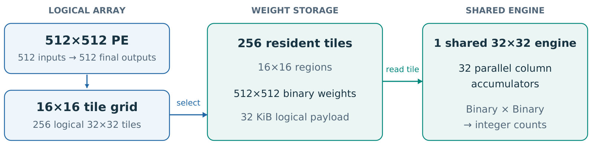
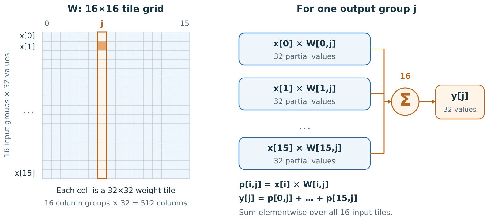
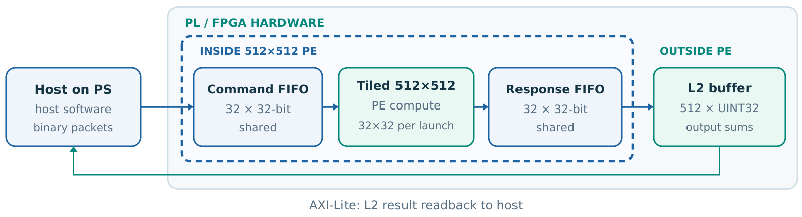

# 512x512 PE architecture

**Tiled execution and output accumulation**  
Architecture note / Digital binary implementation

A full dense **512x512 PE** operation produces **512 final outputs** through **256 tile launches**. One shared **32x32 engine** produces **32 partial integer counts per launch**.

## 1. PE hierarchy and physical execution



| Component | Architecture |
| --- | --- |
| Logical array | 512x512 PE: 512 inputs -> 512 final outputs |
| Tile grid | 16x16 grid: 256 logical 32x32 tiles |
| Weight storage | 256 resident tiles in 16x16 regions; 512x512 binary weights; 32 KiB logical payload |
| Shared engine | One shared 32x32 engine with 32 parallel column accumulators |
| Computation | Binary x binary -> integer counts |

The logical tile grid selects resident weights, and the shared engine reads the selected tile.

**512x512 describes the complete logical operation.** Each launch returns 32 partial counts. L2 combines 16 input-row tile contributions for each of 16 output-column groups to assemble all 512 final outputs.

## 2. How 32x32 tiles implement a 512x512 PE

Split 512 inputs into 16 groups of 32; split `W` into a 16x16 grid of 32x32 tiles.



- Each cell in the weight grid is a 32x32 weight tile.
- There are 16 input groups x 32 values.
- There are 16 column groups x 32 = 512 columns.
- `x[i]` and `y[j]` each denote a group of 32 values.

For one output group `j`, each tile multiplication produces 32 partial values:

```text
p[i,j] = x[i] x W[i,j]
y[j] = p[0,j] + ... + p[15,j]
```

Sum elementwise over all 16 input tiles.

## 3. Concatenate the output groups


| Output group | Output columns |
| --- | --- |
| `y[0]` | 0-31 |
| `y[1]` | 32-63 |
| ... | ... |
| `y[15]` | 480-511 |

The final vector `y` contains **512 UINT32 values**.

Within each group: add partial vectors. Across all 16 groups: concatenate.

## FPGA platform and data flow

**ZCU106 implementation. One FIFO pair serves all 256 logical tiles.**

## 4. Platform terms: PL, PS and host

**PL and PS describe the FPGA platform, not extra levels in the 512x512 PE hierarchy.**

| Term | Meaning |
| --- | --- |
| PL - Programmable Logic | The configurable FPGA fabric: logic, registers and on-chip memory. It implements the engine, weight storage, FIFOs and L2 hardware. |
| PS - Processing System | The built-in Arm processor subsystem. Host software runs here to send tile packets, control execution and read results. |

**PE hardware runs in PL; host software runs on PS.**

## 5. Shared FIFO architecture



```text
Host on PS -> Command FIFO -> Tiled 512x512 PE compute -> Response FIFO -> L2 buffer
```

| Component | Capacity / role | Location |
| --- | --- | --- |
| Host on PS | Host software; binary packets | PS |
| Command FIFO | 32 x 32-bit; shared | Inside 512x512 PE, in PL |
| Tiled 512x512 PE compute | 32x32 per launch | Inside PE, in PL |
| Response FIFO | 32 x 32-bit; shared | Inside 512x512 PE, in PL |
| L2 buffer | 512 x UINT32; output sums | Outside PE, in PL |

AXI-Lite provides L2 result readback to the host.

**Command FIFO + tiled compute + response FIFO belong to the PE. L2 is outside the PE.**

## 6. How L2 is built

L2 is custom RTL hardware: **512 unsigned 32-bit storage entries (2 KiB)**, integer addition logic, and address/control logic. Each response updates the total for its output column. L2 is the accelerator's output accumulator; the PS CPU cache is separate.

```text
L2[32 * j + c] <- L2[32 * j + c] + partial_count
```

`j`: output group 0-15; `c`: local column 0-31. Start from zero and add 16 input-row contributions.

## 7. Launch and drain sequence


1. **Enqueue:** binary packets.
2. **Compute:** one 32x32 tile.
3. **Drain into L2:** 32 responses.
4. **Release:** next queued tile.

**Launch gate:** all 32 responses must be consumed before the next tile executes.

Commands may queue early; compute waits and preserves unread results.

---

Implementation: ZCU106 run report, 23 Nov 2026 | Digital binary RTL  
Platform terminology: AMD Zynq UltraScale+ MPSoC overview (UG1250).
