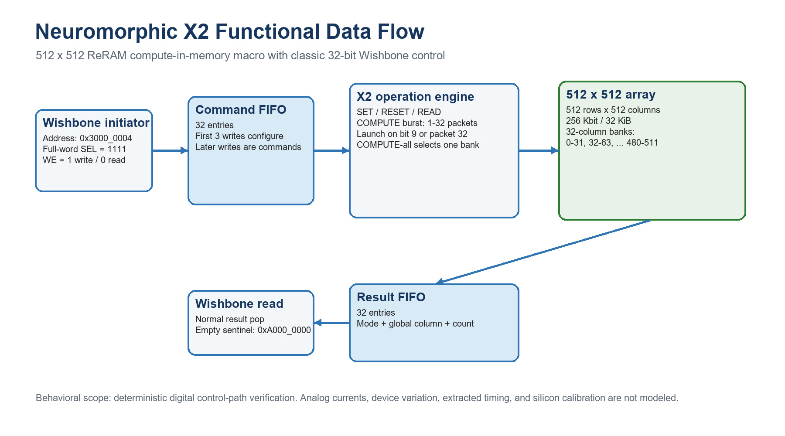

<table>
  <tr>
    <td align="center"></td>
    <td align="center"></td>
  </tr>
</table>

# Neuromorphic X2 512×512 ReRAM Compute-in-Memory IP

Neuromorphic X2 is a 512-row × 512-column ReRAM compute-in-memory hard macro
with a 32-bit classic Wishbone subordinate interface. The logical array contains
262,144 one-bit cells, equivalent to 256 Kibit or 32 KiB. This repository
provides physical hard-macro collateral and a non-synthesizable SystemVerilog
behavioral model for subsystem, firmware and bus-integration simulation.

The behavioral model is intended to validate digital control flow. It does not
replace analog simulation, extracted-parasitic analysis, timing signoff, LVS,
DRC, power-integrity analysis or silicon characterization.

## Key capabilities

- 512×512 logical ReRAM array
- 9-bit global row and column addressing
- SET, RESET, READ and COMPUTE operations
- 32-bit classic Wishbone command/result register
- 32-word input command FIFO
- 32-word output result FIFO
- One through 32 packets per COMPUTE burst
- Single-column and unique-column COMPUTE results
- COMPUTE-all operation for one 32-column CBA bank
- Deterministic digital cell and TDC-count approximation
- Atomic replacement of unread results when a new COMPUTE launches
- Optional wrapper with the hard macro's LEF/LIB/GDS port list
- Scan/debug and decoder-control abstractions for digital verification

## Repository contents

| Path | Description |
|---|---|
| `hdl/beh_model/Neuromorphic_X2_wb_beh.v` | Primary Wishbone behavioral model and optional hard-macro-compatible wrapper |
| `hdl/beh_model/X2_512x512_Wishbone_Behavioral_Model_Guide.docx` | Behavioral-model integration guide |
| `doc/Pin Description.pdf` | Hard-macro pin reference |
| `doc/Process_to_write_to_ReRAM_CIM.png` | Command/result process diagram |
| `doc/reram_cim_process.jpg` | Functional data-flow diagram |
| `doc/symbol.jpg` | Hard-macro interface symbol |
| `doc/timing_diagram.jpg` | Wishbone timing diagram |
| `doc/ReRAM_array_multibit_measured_data.pdf` | ReRAM measurement reference |
| `Neuromorphic_X2.yaml` | IP metadata and register declaration |
| `lef/Neuromorphic_X2_wb.lef` | Physical abstract |
| `lib/Neuromorphic_X2_wb.lib` | Timing/integration library |
| `gds/Neuromorphic_X2_wb.gds` | Hard-macro layout |

The repository does not include a testbench. Integrators should run their own
regression using the protocol and expected behavior documented below.

## Behavioral-model modules

### Primary model

Instantiate `Neuromorphic_X2_wb_beh` for normal functional simulation.

```systemverilog
Neuromorphic_X2_wb_beh #(
  .ADDR_MATCH(32'h3000_0004),
  .READ_DELAY(160),
  .PROGRAM_DELAY(360),
  .COMPUTE_DELAY(450),
  .CONFIG_WRITES(3),
  .INITIAL_CELL_LEVEL(14'h0E23)
) x2_behavior_i (
  .wb_clk_i(wb_clk),
  .wb_rst_i(wb_reset),
  .wbs_cyc_i(wb_cyc),
  .wbs_stb_i(wb_stb),
  .wbs_we_i(wb_we),
  .wbs_sel_i(wb_sel),
  .wbs_adr_i(wb_address),
  .wbs_dat_i(wb_write_data),
  .wbs_dat_o(wb_read_data),
  .wbs_ack_o(wb_ack),
  .i_scan_si1(1'b0),
  .i_scan_se1(1'b0),
  .i_TM(1'b0),
  .o_TM(),
  .o_mux_sel(),
  .o_sl_float(), .o_sl_addr(), .o_sl_data(),
  .o_bl_float(), .o_bl_addr(), .o_bl_data(),
  .o_wl_float(), .o_wl_addr(), .o_wl_data()
);
```

### Optional hard-macro-compatible wrapper

Defining `NEUROMORPHIC_X2_WB_BEH_AS_RTL` also compiles a module named
`Neuromorphic_X2_wb`. Its port names and widths match the physical macro
interface, allowing a simulation flow to substitute the behavioral model for
the hard macro without changing the top-level macro connections.

```text
iverilog -g2012 -DNEUROMORPHIC_X2_WB_BEH_AS_RTL ...
```

The wrapper models only the functional Wishbone path. `user_clk`, `user_rst`,
analog pins, power pins and physical scan-chain behavior are not electrically
modeled. `ScanOutCC` is held at zero. Use the primary model when direct access
to the abstract decoder-control outputs is required.

## Parameters

| Parameter | Default | Meaning |
|---|---:|---|
| `ADDR_MATCH` | `32'h3000_0004` | Accepted Wishbone byte address |
| `READ_DELAY` | `160` | Behavioral clock cycles before a READ result |
| `PROGRAM_DELAY` | `360` | Base behavioral delay for SET/RESET |
| `COMPUTE_DELAY` | `450` | Behavioral clock cycles before COMPUTE result generation |
| `CONFIG_WRITES` | `3` | Number of startup configuration writes |
| `INITIAL_CELL_LEVEL` | `14'h0E23` | Initial analog-level approximation before configuration completes |

Reducing delays in a testbench shortens simulation without changing packet,
address, FIFO or result semantics.

## Primary model ports

### Wishbone ports

| Port | Direction | Width | Description |
|---|---|---:|---|
| `wb_clk_i` | Input | 1 | Wishbone and behavioral-model clock |
| `wb_rst_i` | Input | 1 | Active-high reset |
| `wbs_cyc_i` | Input | 1 | Classic Wishbone cycle qualifier |
| `wbs_stb_i` | Input | 1 | Transfer request strobe |
| `wbs_we_i` | Input | 1 | `1` for write, `0` for read |
| `wbs_sel_i` | Input | 4 | Must be `4'b1111` for a valid full-word access |
| `wbs_adr_i` | Input | 32 | Must equal `ADDR_MATCH` |
| `wbs_dat_i` | Input | 32 | Configuration or command word |
| `wbs_dat_o` | Output | 32 | Result, status or empty-result word |
| `wbs_ack_o` | Output | 1 | Transfer acknowledgement |

### Scan/debug ports

| Port | Direction | Description |
|---|---|---|
| `i_scan_si1` | Input | Serial scan/debug data |
| `i_scan_se1` | Input | Scan/debug shift control used by the model |
| `i_TM` | Input | Test-mode enable |
| `o_TM` | Output | Test-mode reflection |

### Abstract array-control ports

The 512-bit word-line, bit-line and source-line outputs expose an abstract view
of the active decoder selections. They are provided for digital control-path
verification and do not model analog voltage, current, slew or loading.

| Port group | Description |
|---|---|
| `o_wl_addr`, `o_bl_addr`, `o_sl_addr` | Selected global line masks |
| `o_wl_data`, `o_bl_data`, `o_sl_data` | Abstract driven-line values |
| `o_wl_float`, `o_bl_float`, `o_sl_float` | Abstract floating-line masks |
| `o_mux_sel` | Abstract mode-dependent mux selection |

## Wishbone protocol

The model implements one full-word register at `0x3000_0004` by default.

A transfer is selected only when all of the following are true:

```text
wbs_cyc_i = 1
wbs_stb_i = 1
wbs_sel_i = 4'b1111
wbs_adr_i = ADDR_MATCH
```

An invalid address or partial byte select receives no acknowledgement.

### Write transfer

1. Drive address, data, select and `wbs_we_i=1`.
2. Assert `wbs_cyc_i` and `wbs_stb_i`.
3. Hold all request signals stable until `wbs_ack_o=1`.
4. Deassert `wbs_cyc_i` and `wbs_stb_i` before another transfer.

A write ACK means that the word entered the command FIFO. It does not mean the
array operation or result generation has completed. When the 32-word command
FIFO is full, the model withholds ACK until space becomes available.

### Read transfer

1. Drive `ADDR_MATCH`, `4'b1111` and `wbs_we_i=0`.
2. Assert `wbs_cyc_i` and `wbs_stb_i`.
3. Sample `wbs_dat_o` when `wbs_ack_o=1`.
4. Deassert `wbs_cyc_i` and `wbs_stb_i` before another transfer.

Normal reads are acknowledged immediately. If the result FIFO is empty, the
model returns:

```text
0xA000_0000
```

During the short atomic FIFO-flush handshake at a COMPUTE launch, bus access
may be delayed briefly. This prevents a simultaneous read from racing the
discard of the older result stream.

## Reset and startup

`wb_rst_i` is active high. Reset clears:

- Command and result FIFO state
- All 512×512 digital cell-state bits
- COMPUTE packet accumulation
- Status and status-read selection
- Configuration progress
- Scan/debug state
- Active functional decoder masks

After reset, exactly three accepted writes are interpreted as configuration
words. They are not decoded as normal commands and do not generate results.
Configuration can be restarted only by asserting `wb_rst_i`.

## Configuration-word formats

### Configuration word 0: SET targets

| Bits | Field |
|---|---|
| `[15:0]` | `target_set1` |
| `[31:16]` | `target_set2` |

The behavioral SET target is the truncated midpoint of these two values.

### Configuration word 1: RESET targets

| Bits | Field |
|---|---|
| `[15:0]` | `target_reset1` |
| `[31:16]` | `target_reset2` |

The behavioral RESET target is the truncated midpoint of these two values.

### Configuration word 2: timing fields

| Bits | Field |
|---|---|
| `[9:0]` | `no_of_clk_cycles` |
| `[19:10]` | `counter_value` |
| `[26:20]` | `tdc_time_out` |
| `[29:27]` | Reserved by the behavioral model |
| `[31:30]` | `tdc_dead_time` |

After the third configuration word, the model initializes every cell's
behavioral analog level to the configured RESET midpoint while keeping every
digital `array_state` bit cleared.

## Command-word format

After configuration, all accepted writes use this frame:

| Bits | Field | Description |
|---|---|---|
| `[31:30]` | Mode | `00` RESET, `01` READ, `10` COMPUTE, `11` SET |
| `[29:21]` | Row | Global row address, 0–511 |
| `[20:12]` | Column | Global column address, 0–511 |
| `[11]` | Status-read enable | When set, subsequent Wishbone reads return status instead of FIFO data |
| `[10]` | COMPUTE-all | Select all 32 columns in the addressed CBA bank |
| `[9]` | COMPUTE launch | Final-packet/launch marker |
| `[8]` | Reserved | Drive zero |
| `[7:0]` | PWM | Programming, read-offset or COMPUTE input value |

The 9-bit row and column fields can also be viewed as tiled coordinates:

```text
global row    = {tile_row[3:0], local_row[4:0]}
global column = {tile_column[3:0], local_column[4:0]}
```

## Operation behavior

### SET

SET uses mode `2'b11`.

1. Select the global row and column.
2. Wait `PROGRAM_DELAY + no_of_clk_cycles` behavioral clocks.
3. Set `array_state[row][column]` to one.
4. Set the cell-level approximation to the configured SET midpoint plus the
   command PWM value.
5. Generate one automatic readback result for the programmed column.

### RESET

RESET uses mode `2'b00`. This is a cell-programming operation and is different
from asserting `wb_rst_i`.

1. Select the global row and column.
2. Wait `PROGRAM_DELAY + no_of_clk_cycles` behavioral clocks.
3. Clear `array_state[row][column]` to zero.
4. Set the cell-level approximation to the configured RESET midpoint plus the
   command PWM value.
5. Generate one automatic readback result for the programmed column.

SET/RESET automatic readback uses the PWM retained from the most recent READ
command. It is initialized to zero after model reset.

### READ

READ uses mode `2'b01`.

1. Select one global row and column.
2. Save the command PWM as `previous_read_pwm`.
3. Wait `READ_DELAY` behavioral clocks.
4. Return one result containing the selected column and a clamped count.

The behavioral count is:

```text
cell_level[row][column] + command PWM
```

### COMPUTE packet accumulation

COMPUTE uses mode `2'b10` and accepts one through 32 packets.

For each packet, the model:

- Adds the packet row to a 512-row selection mask
- Stores the packet PWM for that row
- Adds the packet column to the unique-column mask unless COMPUTE-all is active
- Remembers the selected 32-column bank when bit 10 is set

If a row appears more than once, it remains selected once and the latest PWM
for that row replaces the older PWM. In normal COMPUTE mode, repeated columns
produce one result because the column mask is unique.

A COMPUTE launches when command bit 9 is one or when packet 32 is accepted.
Packets 1–31 with bit 9 clear accumulate state without launching and do not
flush the result FIFO. A non-COMPUTE command clears a partially accumulated
COMPUTE burst.

### Normal COMPUTE

Normal COMPUTE produces one output for each unique selected column, in
ascending global-column order. The count for a column is:

```text
sum(PWM[row]) for every selected row where array_state[row][column] = 1
```

The behavioral COMPUTE arithmetic uses the digital SET/RESET state and packet
PWM values. It does not use transistor-level conductance or analog current.

### COMPUTE-all

When bit 10 is set, the supplied global column selects one 32-column bank:

```text
bank      = global_column[8:5]
bank_base = bank × 32
results   = bank_base through bank_base + 31
```

| Bank | Supplied column range | Returned global columns |
|---:|---:|---:|
| 0 | 0–31 | 0–31 |
| 1 | 32–63 | 32–63 |
| 2 | 64–95 | 64–95 |
| 3 | 96–127 | 96–127 |
| 4 | 128–159 | 128–159 |
| 5 | 160–191 | 160–191 |
| 6 | 192–223 | 192–223 |
| 7 | 224–255 | 224–255 |
| 8 | 256–287 | 256–287 |
| 9 | 288–319 | 288–319 |
| 10 | 320–351 | 320–351 |
| 11 | 352–383 | 352–383 |
| 12 | 384–415 | 384–415 |
| 13 | 416–447 | 416–447 |
| 14 | 448–479 | 448–479 |
| 15 | 480–511 | 480–511 |

COMPUTE-all always produces exactly 32 result words in ascending global-column
order. It does not produce all 512 columns in one operation. A full-array sweep
requires 16 bank operations.

If more than one packet in a COMPUTE burst sets bit 10, the most recent such
packet selects the bank. After COMPUTE-all has been enabled, later ordinary
column selections in that burst are ignored, but their rows and PWM values are
still accumulated.

## Result-FIFO replacement policy

Every COMPUTE launch atomically discards all unread output-FIFO words before
the new computation delay begins. This is a deliberate latest-COMPUTE-wins
policy.

Example:

```text
COMPUTE 1 produces 32 results
User reads 10
22 old results remain
COMPUTE 2 launches
All 22 unread results are invalidated
COMPUTE 2 produces its new result stream
```

For COMPUTE-all, the new 32-word stream fills the entire result FIFO and no
word from the previous operation remains readable.

Important details:

- The flush happens when the command executor launches COMPUTE, not merely
  when the Wishbone write is acknowledged.
- Packets accumulating before the launch marker do not flush the FIFO.
- The flush applies to unread SET, RESET, READ and COMPUTE responses.
- The array contents and configuration registers are not erased.
- If reset interrupts the new COMPUTE after the flush, the older results remain
  discarded and the interrupted operation produces no result.
- SET, RESET and READ operations do not flush the output FIFO themselves.

This policy ensures that a new COMPUTE-all operation always has all 32 FIFO
entries available. Software that needs every operation's results must drain
each stream before launching the next COMPUTE.

## Count saturation

READ and COMPUTE counts are limited by:

```text
timeout ceiling = {tdc_time_out[5:0], 8'hFF}
```

If a raw count exceeds the ceiling, the returned count saturates at the
ceiling instead of wrapping.

## Result-word format

| Bits | Field | Description |
|---|---|---|
| `[31:25]` | Reserved | Zero for a normal valid result |
| `[24:23]` | Mode | Operation that generated the result |
| `[22:14]` | Column | Global minuend/result column |
| `[13:8]` | Coarse/count upper bits | Upper six bits of the 14-bit value |
| `[7:0]` | Fine/count lower bits | Lower eight bits of the 14-bit value |

The complete count is `result[13:0]`.

The interface documentation reserves adjacent physical columns for a signed
differential convention: result column `2*n` corresponds to column `2*n`
minus column `2*n+1`, and the reverse direction is identified by column
`2*n+1`. The present behavioral arithmetic functions generate a clamped,
non-negative per-column count and do not subtract the adjacent column. Treat
`result[13:0]` as an unsigned behavioral count unless differential arithmetic
is added to the model.

## Status-read behavior

Command bit 11 controls whether Wishbone reads return FIFO data or the 3-bit
status code.

When the most recently processed command has bit 11 set:

```text
wbs_dat_o = {29'b0, status_code}
```

The result FIFO is not popped by these status reads. A later command with bit
11 clear restores normal result reads.

Defined status encodings are:

| Code | Name |
|---:|---|
| `3'b000` | OK |
| `3'b001` | READ timeout/reserved failure indication |
| `3'b011` | SET failure indication |
| `3'b100` | COMPUTE timeout indication |
| `3'b101` | RESET failure indication |

The current deterministic model normally reports `OK`; it does not model
analog failure probabilities.

## FIFO and scheduling behavior

### Command FIFO

- Depth: 32 words
- Width: 32 bits
- Wishbone writes can continue while READ, SET, RESET or COMPUTE delays run
- A full command FIFO backpressures writes by withholding ACK
- The command executor processes commands sequentially

### Result FIFO

- Depth: 32 words
- Width: 32 bits
- SET, RESET and READ append one result each
- Normal COMPUTE appends 1–32 unique-column results
- COMPUTE-all appends exactly 32 results
- A normal empty read returns `0xA000_0000`
- A new COMPUTE launch discards the complete unread result stream first

Because COMPUTE always flushes before producing results, result-FIFO-full
waiting should not occur during a single new COMPUTE stream. Non-COMPUTE
results can still fill the FIFO; their producers wait for space if software
does not read them and no COMPUTE supersedes them.

## Programming examples

### SystemVerilog command builder

```systemverilog
function automatic logic [31:0] x2_command(
  input logic [1:0] mode,
  input logic [8:0] row,
  input logic [8:0] column,
  input logic status_read,
  input logic all_columns,
  input logic compute_launch,
  input logic [7:0] pwm
);
  return {mode, row, column, status_read, all_columns,
          compute_launch, 1'b0, pwm};
endfunction
```

### C-style command builder

```c
#include <stdint.h>

static inline uint32_t x2_command(
    uint32_t mode,
    uint32_t row,
    uint32_t column,
    uint32_t status_read,
    uint32_t all_columns,
    uint32_t launch,
    uint32_t pwm)
{
    return ((mode        & 0x3u)   << 30) |
           ((row         & 0x1FFu) << 21) |
           ((column      & 0x1FFu) << 12) |
           ((status_read & 0x1u)   << 11) |
           ((all_columns & 0x1u)   << 10) |
           ((launch      & 0x1u)   << 9)  |
           (pwm          & 0xFFu);
}
```

### COMPUTE-all example

To compute bank 2, covering global columns 64–95:

```text
mode            = 2'b10
row             = selected input row
column          = 68
status_read     = 0
all_columns     = 1
compute_launch  = 1 on the final packet
pwm             = input value for that row
```

Read exactly 32 valid result words and verify that `result[22:14]` runs from
64 through 95. An additional normal read returns `0xA000_0000`.

### Full 512-column sweep

Perform 16 separate COMPUTE-all operations. Because each new COMPUTE discards
unread results, drain all 32 results from one bank before launching the next.

```text
Bank 0  → columns 0–31    → read 32 results
Bank 1  → columns 32–63   → read 32 results
...
Bank 15 → columns 480–511 → read 32 results
```

## Verification status

The current source was compiled with SystemVerilog enabled and checked using
an external simulation regression. No testbench was added to this repository.

The baseline regression passed these 12 scenarios:

1. Reset state and empty-result sentinel
2. Exact address and full-word byte-select qualification
3. Three-word configuration sequence
4. SET at global row 300, column 68 with automatic result
5. READ at global row 300, column 68
6. RESET at global row 300, column 68 with automatic result
7. Single-packet COMPUTE launch
8. Multi-packet COMPUTE accumulation
9. COMPUTE-all for columns 64–95
10. COMPUTE-all for final bank columns 480–511
11. Maximum row and column address 511
12. Result-FIFO drain and final empty-result sentinel

The COMPUTE replacement-policy regression additionally passed:

1. Twenty-two unread old results replaced by a new 32-result bank stream
2. Completely full 32-word old stream atomically replaced
3. Packets accumulating before launch preserve the older stream
4. COMPUTE launch replaces an unread SET response
5. Packet 32 automatically launches and replaces the old stream
6. Reset during COMPUTE cancels the operation and leaves the FIFO empty

The optional `Neuromorphic_X2_wb` hard-macro-compatible wrapper also compiles
successfully.

These tests provide broad functional coverage but are not an exhaustive proof
of all 512×512 cell contents, every possible packet sequence, analog behavior
or physical implementation. Customers should add system-specific tests for
their bus master, reset sequencing, software timeouts and expected workloads.

## Integration checklist

- Use SystemVerilog compilation (`-g2012` or equivalent)
- Assert active-high `wb_rst_i` before configuration
- Send exactly three configuration writes after reset
- Use address `0x3000_0004`, unless `ADDR_MATCH` is intentionally overridden
- Use `wbs_sel_i=4'b1111`
- Hold each Wishbone request until ACK, then release `CYC/STB`
- Treat write ACK as command acceptance, not operation completion
- Keep command bit 8 at zero
- Keep bit 11 clear when reading normal FIFO results
- Count expected results for normal COMPUTE
- Read exactly 32 results for COMPUTE-all
- Drain a result stream before launching another COMPUTE if older results are needed
- Treat `0xA000_0000` as the normal empty-result sentinel
- Do not synthesize the behavioral model
- Use LEF/LIB/GDS and signoff views for physical implementation

## Modeling limitations

- The model is non-synthesizable and uses behavioral tasks, waits and large
  simulation arrays.
- ReRAM conductance, variability, endurance, retention and stochastic
  programming are not modeled.
- TDC behavior is represented by deterministic count arithmetic.
- Analog supply pins and bias pins have no electrical effect in the wrapper.
- Timing parameters represent abstract clock delays, not characterized silicon
  timing.
- The physical scan chain is not reproduced by the hard-macro-compatible
  wrapper.
- Differential adjacent-column subtraction is documented at the interface but
  is not implemented in the current count arithmetic.
- Verification does not replace customer system-level, AMS, gate-level or
  post-layout verification.

<p align="center">
  
</p>
