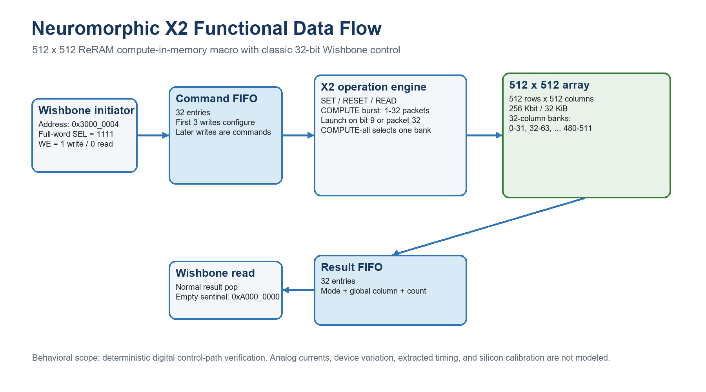

<table>
  <tr>
    <td align="center"></td>
    <td align="center"></td>
  </tr>
</table>

# Neuromorphic X2 Analog In-Memory Compute IP Macro

Neuromorphic X2 is a 512 x 512 ReRAM compute-in-memory hard macro with a
256-Kbit non-volatile array and a 32-bit classic Wishbone subordinate
interface. The repository contains physical integration collateral and a
digital behavioral model for functional subsystem simulation.

## Key features

- 512 rows x 512 columns, equivalent to 256 Kbit or 32 KiB of one-bit cell state
- SET, RESET, READ, and COMPUTE commands
- 9-bit global row and column addressing
- Independent 32-word command and result FIFOs
- Variable-length COMPUTE bursts containing 1 through 32 packets
- COMPUTE-all selection of one 32-column bank
- Deterministic digital read and compute results for control-path verification

## Repository contents

| Path | Purpose |
|---|---|
| `hdl/beh_model/Neuromorphic_X2_wb_beh.v` | Digital Wishbone behavioral model |
| `hdl/beh_model/X2_512x512_Wishbone_Behavioral_Model_Guide.docx` | Behavioral-model integration guide |
| `doc/Pin Description.pdf` | Hard-macro pin and electrical interface reference |
| `lef/Neuromorphic_X2_wb.lef` | Physical abstract |
| `lib/Neuromorphic_X2_wb.lib` | Timing and integration library |
| `gds/Neuromorphic_X2_wb.gds` | Hard-macro layout |

The repository does not include a testbench. Integrators should verify the
model in their own Wishbone environment using the requirements below.

## Wishbone interface

The IP uses one 32-bit data register at the default byte address
`0x3000_0004`.

| Signal | Direction | Description |
|---|---|---|
| `wb_clk_i` | Input | Wishbone clock; transfers are sampled on the rising edge |
| `wb_rst_i` | Input | Active-high model and Wishbone reset |
| `wbs_cyc_i` | Input | Bus-cycle qualifier |
| `wbs_stb_i` | Input | Transfer request strobe |
| `wbs_we_i` | Input | `1` for write, `0` for read |
| `wbs_sel_i[3:0]` | Input | Must be `4'b1111` for an accepted full-word transfer |
| `wbs_adr_i[31:0]` | Input | Must equal `0x3000_0004`, unless `ADDR_MATCH` is overridden |
| `wbs_dat_i[31:0]` | Input | Write data |
| `wbs_dat_o[31:0]` | Output | Read data |
| `wbs_ack_o` | Output | Transfer acknowledgement |

The initiator must hold the request and associated address/control/data stable
until `wbs_ack_o` is observed, then deassert `wbs_cyc_i` and `wbs_stb_i` before
starting the next classic transfer. Writes may wait while the command FIFO is
full. Reads are acknowledged immediately; an empty normal read returns
`0xA000_0000`.

## Startup and command flow

1. Assert `wb_rst_i`, then release it.
2. Write exactly three configuration words. These writes do not produce results.
3. Write SET, RESET, READ, or COMPUTE command words.
4. Read result words from the same Wishbone address.

Configuration can be restarted only by resetting the behavioral model.

### Command frame

| Bits | Field |
|---|---|
| `[31:30]` | Mode: `00` RESET, `01` READ, `10` COMPUTE, `11` SET |
| `[29:21]` | Row address, 0 through 511 |
| `[20:12]` | Column address, 0 through 511 |
| `[11]` | Status-read enable |
| `[10]` | COMPUTE-all columns in the addressed 32-column bank |
| `[9]` | COMPUTE launch/final-packet marker |
| `[8]` | Reserved; drive zero |
| `[7:0]` | PWM value |

A COMPUTE burst launches when bit 9 is set or when packet 32 is accepted.
Ordinary COMPUTE produces one result for each unique selected column.
COMPUTE-all produces exactly 32 results for the bank selected by
`column[8:5]`.

### Result frame

| Bits | Field |
|---|---|
| `[31:25]` | Reserved, zero for a valid result |
| `[24:23]` | Result mode |
| `[22:14]` | Global column address |
| `[13:0]` | Coarse/fine count field |

## Behavioral and physical integration

`Neuromorphic_X2_wb_beh` is the primary simulation module. Defining
`NEUROMORPHIC_X2_WB_BEH_AS_RTL` also enables a wrapper named
`Neuromorphic_X2_wb` whose port names and widths match the hard-macro
LEF/LIB/GDS interface. The wrapper models the functional Wishbone path only;
analog supplies, electrical behavior, and physical scan-chain behavior are not
modeled.

The behavioral model is not synthesizable and does not replace analog,
extracted-parasitic, timing-closure, LVS, or silicon verification.

  

