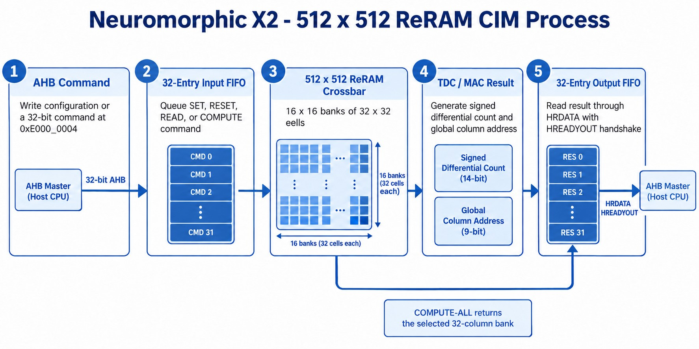

<table>
  <tr>
    <td align="center"></td>
    <td align="center"></td>
  </tr>
</table>

# Neuromorphic X2 - 512 x 512 AHB Analog In-Memory Compute IP

Neuromorphic X2 is a 512 x 512 ReRAM compute-in-memory IP macro combining 256 Kb of non-volatile storage with analog multiply-accumulate operations. The supplied behavioral model is controlled through a 32-bit AHB subordinate interface and is intended for digital and AMS control-path integration.

## Key features

- 512 x 512 ReRAM crossbar organized as 16 x 16 tiles of 32 x 32 cells
- 32-entry input FIFO and 32-entry output FIFO
- SET, RESET, READ, COMPUTE, and bank-local COMPUTE-ALL operations
- 32-bit AHB subordinate interface with wait-state support
- Fixed default data-register address `0xE000_0004`, parameterized by `ADDR_MATCH`
- TDC-style result words with 9-bit global column addresses
- Deterministic behavioral memory and TDC response for repeatable simulation
- Self-checking SystemVerilog testbench covering 172 checks

## Data flow

```text
AHB write transfer
       |
       v
32-entry command FIFO
       |
       v
Configuration / SET / RESET / READ / COMPUTE
       |
       v
512 x 512 ReRAM crossbar model
       |
       v
TDC read or MAC result
       |
       v
32-entry response FIFO
       |
       v
AHB read transfer
```

<p align="center">
  
</p>

## AHB interface

The model is an AHB subordinate. A transfer is accepted when `HSEL=1`, `HTRANS[1]=1`, and upstream `HREADY=1`. Word transfers use `HSIZE=3'b010`.

| Item | Value |
|---|---|
| Default register address | `0xE000_0004` |
| Data width | 32 bits |
| Address width | 32 bits |
| Reset | `HRESETn`, active low |
| Response | `HRESP=2'b00` for OKAY, `2'b01` for ERROR |
| Write back-pressure | `HREADYOUT` is low while the command FIFO cannot accept a transfer |
| Read back-pressure | `HREADYOUT` is low until a result is available |
| Empty read sentinel | `0xA000_0000` when an empty-read response is returned |

The full port list and integration rules are in [doc/Pin Description.pdf](doc/Pin%20Description.pdf) and [hdl/beh_model/X2_512x512_AHB_Design_Guide.md](hdl/beh_model/X2_512x512_AHB_Design_Guide.md).

## Command frame

| Bits | Field | Meaning |
|---:|---|---|
| `31:30` | Mode | `00` RESET, `01` READ, `10` COMPUTE, `11` SET |
| `29:21` | Row | Global row address, 0 to 511 |
| `20:12` | Column | Global column address, 0 to 511 |
| `11` | Status request | Return FSM error/status on a read |
| `10` | Compute all columns | Compute the 32 columns in the selected 32-column bank |
| `9` | Compute start | Final COMPUTE packet and launch marker |
| `8` | Reserved | Write zero |
| `7:0` | PWM | Input pulse-width value |

The first three accepted writes after reset are configuration words. COMPUTE accepts 1 through 32 packets and launches when bit 9 is set or the 32nd packet is accepted. A non-COMPUTE command discards a partial COMPUTE burst.

For COMPUTE-ALL, the command's global column selects one of sixteen 32-column banks: 0-31, 32-63, and so on through 480-511. Exactly 32 results, with their global column addresses, are queued for that selected bank.

## Result frame

| Bits | Field |
|---:|---|
| `31:25` | Reserved, zero |
| `24:23` | Operation mode |
| `22:14` | Global minuend column address |
| `13:8` | Coarse count |
| `7:0` | Fine count |

Physical columns are paired as `(2*n, 2*n+1)`. Result column `2*n` contains column `2*n - column 2*n+1`; result column `2*n+1` contains the opposite difference. Bits `13:0` are a signed 14-bit two's-complement differential count.

## Package contents

| Path | Purpose |
|---|---|
| `hdl/beh_model/Neuromorphic_X2_ahb_beh.v` | 512 x 512 AHB behavioral model |
| `hdl/beh_model/tb_Neuromorphic_X2_ahb_beh.sv` | Self-checking AHB testbench |
| `hdl/beh_model/X2_512x512_AHB_Design_Guide.md` | Design and integration guide |
| `hdl/beh_model/X2_512x512_AHB_Testbench_Guide.md` | Testbench and verification guide |
| `doc/Pin Description.pdf` | AHB and physical-macro pin description |
| `doc/symbol.jpg` | AHB block symbol |
| `doc/timing_diagram.jpg` | AHB transfer timing overview |
| `doc/reram_cim_process.jpg` | AHB command-to-result process flow |
| `doc/Process_to_write_to_ReRAM_CIM.png` | Step-by-step AHB model usage workflow |
| `doc/ReRAM_array_multibit_measured_data.pdf` | ReRAM array measured-data reference |
| `gds/Neuromorphic_X2_ahb.gds` | Provisional AHB-named layout view |
| `lef/Neuromorphic_X2_ahb.lef` | Provisional AHB abstract view |
| `lib/Neuromorphic_X2_ahb.lib` | Provisional AHB interface-only Liberty view |
| `tools/build_pin_description_pdf.py` | Reproducible pin-description PDF generator |

## Running the supplied testbench

With Icarus Verilog installed:

```sh
iverilog -g2012 -o x2_ahb_sim \
  hdl/beh_model/Neuromorphic_X2_ahb_beh.v \
  hdl/beh_model/tb_Neuromorphic_X2_ahb_beh.sv
vvp x2_ahb_sim
```

The expected completion message is `TEST_PASS: 172 checks completed`.

## Physical-view qualification notice

The supplied GDS, LEF, and Liberty files are provisional interface-alignment views. Their macro name and external pin set have been aligned to the behavioral AHB interface for packaging and integration planning. They do not constitute a placed-and-routed, extracted, or characterized AHB hard macro. Before fabrication, regenerate the physical implementation from the AHB RTL/netlist, run DRC/LVS and parasitic extraction, characterize timing and power, and confirm pin geometry across GDS, LEF, Liberty, netlist, and top-level integration.
